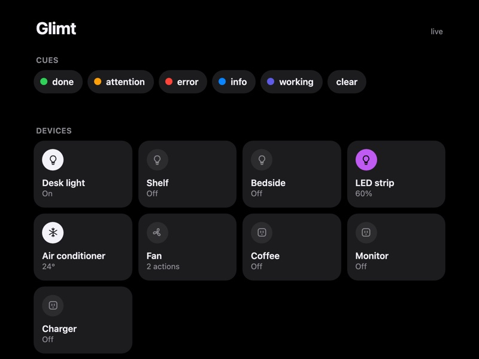

# Glimt

**Cue lights for AI agents.** When your coding agent finishes, gets stuck or fails, your
room tells you: a lamp pulses green, the LED strip holds amber, a tone plays. Then your
lights go back to exactly how they were.

It runs on the computer you already keep on: no hub, no spare machine, about 100 MB of
memory. Your agents can control the room too ("turn on the bay window light" from ChatGPT
on your phone), and the same devices show up in Apple Home.

*Glimt* is Norwegian for a flash of light caught in the corner of your eye.

```bash
glimt connect          # one step: Claude Code and Codex now cue you
glimt signal done      # or fire one yourself, from anything
glimt run -- make test # or wrap any command: green when it passes, red when it fails
```



## Why

Agents now work for minutes at a time, so you look away. Then you lose ten minutes
because the agent finished, or stopped to ask a question, and the notification was
buried under forty others.

A light in the corner of your eye does not get buried. Theatres have long used *cue lights*
for exactly this: a silent signal to someone whose eyes are busy elsewhere.

Asking a chatbot to turn on the lamp works here too, and it makes a good demo, but the
switch on the wall is faster. The useful direction is the reverse: the agent gets *your*
attention, through the room instead of through another screen.

## The five cues

| Cue | Looks like | Use it when |
| --- | --- | --- |
| `done` | two green pulses, soft tone, lights restore | a long task finished |
| `attention` | amber, and it **stays** amber until you deal with it | the agent is blocked on you |
| `error` | three sharp red flashes | something failed |
| `info` | one blue pulse, silent | worth knowing, not worth a sound |
| `working` | dim indigo glow until cleared | a long job is running |

Add your own in three lines of config, or pass a colour and a pattern:
`glimt signal --color pink --pattern breathe -m "PR approved"`.
Every cue snapshots the lights it borrows and restores them afterwards, so a cue never
leaves your room in a different state than it found it. [More on cues](docs/signals.md)

## Try it in a minute, without any hardware

```bash
pipx install "glimt[all] @ git+https://github.com/afknavs/glimt"
glimt demo             # simulated lights in your browser
glimt signal attention -m "Need a decision on the migration"
```

Requires Python 3.11+. It runs on macOS every day; it is written for Linux and a
Raspberry Pi too, where it is so far untested. [Where to run it](docs/where-to-run.md)

### Or let your agent set it up

Paste this into Claude Code, Codex or any agent that can run commands on your computer:

> Set up Glimt for me from https://github.com/afknavs/glimt. Follow the "set it up for
> someone" section of its AGENTS.md. I have: *(say what you own, e.g. Smart Life bulbs
> and a Bluetooth LED strip)*.

It installs Glimt, shows you the demo, and stops where a person is needed: scanning a QR
code in your smart-home app, or pressing the button on a Hue bridge.

## Then connect your real lights

```bash
glimt setup            # pick what you own; it finds the devices and writes the config
```

That one command also offers to start Glimt at login, connect Claude Code and Codex,
and add the menu bar app. Each is a yes or no, and each has its own command if you would
rather do it later:

```bash
glimt doctor           # checks everything and tells you exactly what to fix
glimt connect          # wires up Claude Code and Codex
glimt app install      # the macOS menu bar app
```

| Works with | How | Status |
| --- | --- | --- |
| **Tuya / Smart Life** bulbs, plugs, strips, air conditioners | local network first, cloud only when a device cannot do LAN | used daily on real hardware |
| **Bluetooth LED strips** (ELK-BLEDOM, MELK, "Lotus Lamp" strips) | one persistent BLE connection | used daily on real hardware |
| **Home Assistant** | anything it already controls, over one WebSocket | tested against a simulated server; hardware reports welcome |
| **Philips Hue** | bridge API v2 with pushed state | tested against a simulated bridge; hardware reports welcome |
| **WLED** | local JSON API | tested against a simulated strip; hardware reports welcome |
| **This computer's speaker** | a tone or a spoken sentence with each cue | macOS and Linux |

**Yours is not on the list?** Bridges are one Python file, and the contract is written
so an agent can do it for you. Paste this into your coding agent:

> Read `docs/bridges.md` in the glimt repo and write a bridge for my *<device>*.
> Verify it with `glimt bridge test`.

It will show up in the CLI, the MCP tools, the cues, the dashboard, the menu bar app and
Apple Home without touching any of them. [Bridge guide](docs/bridges.md)

## How agents use it

**1. Hooks (recommended).** `glimt connect` adds lifecycle hooks to Claude Code and
Codex. The agent does not decide to cue you and spends no tokens on it; the harness
fires the cue the moment a turn ends or a permission prompt appears.

- A turn shorter than 20 seconds stays quiet: you were watching.
- A blocked agent holds amber, and it clears itself when you answer.
- `glimt mute 60` (or the bell in the menu bar) when you need an hour of quiet.
- Undo with `glimt disconnect`. [Details](docs/connecting-agents.md)

**2. Tools.** The MCP server gives an agent `signal`, `clear_signal`, `control`,
`action` and `devices`. It is built to be cheap: five tools, the device list is baked
into a tool description (no "list devices first" round trip), and replies are a few
words.

**3. Agents in the cloud.** ChatGPT, an OpenAI dot or any other agent that does not run
on your computer gets the same five tools over HTTPS: `glimt remote enable`, paste the
address into the app, and confirm on your computer the code its sign-in page shows.
[Remote access](docs/remote.md)

**4. Anything else.** A CLI and a local HTTP API. A cue from a shell script, a CI
watcher, a cron job or a git hook is one line. [API](docs/api.md)

## Fast, and measured

Glimt began as a fix for my own setup, where "turn on the light" through an agent
took about ten seconds. Measuring it showed two different problems.

**The device path** was doing a Bluetooth scan and connect, or a fresh TCP handshake and
a read-before-write, for every command. Glimt keeps one connection per device open.
Same hardware, same room:

| | Before | After |
| --- | --- | --- |
| Read every device's state | 300–1000 ms | 2–5 ms |
| Wi-Fi bulb on/off | 1.5–1.8 s | 50–150 ms |
| Smart plug on/off | 180–270 ms | ~30 ms |
| Bluetooth strip colour | 3.0–3.2 s | ~95 ms |
| Air conditioner (cloud only) | ~500 ms | ~60 ms |
| Fire a cue from the shell | n/a | 40–70 ms, start to finish |

**The agent path** was the bigger half: a 19.7 second agent turn contained 0.46 seconds
of device time. The rest was the model making three round trips. No device code can fix
that, which is why cues come from hooks: zero round trips. [The full write-up](docs/latency.md)

## Apps

- **Menu bar app (macOS).** Who is waiting for you and why, a bell to mute cues, and
  your room as a grid of tiles: click a tile's icon to switch it, click the tile for its
  controls. A thermostat gets a wide tile with its temperature; a set of outlets folds
  into one. The lightbulb in the menu bar fills with the cue's colour while an agent is
  waiting.
  `glimt app install` builds it on your Mac in a few seconds (needs Apple's command
  line tools: `xcode-select --install`). [Everything it does](docs/menu-bar.md)
- **Dashboard.** `glimt open`.
- **Apple Home.** Export every device to the Home app, Siri and Shortcuts, with changes
  pushed instantly rather than polled. Works on your home Wi-Fi; from outside, Apple
  needs a HomePod or Apple TV in the house. [Setup](docs/homekit.md)

 

## Private by design

- The daemon listens on `127.0.0.1` only, and every request needs a token that only
  your user account can read.
- Remote access is off until you turn it on. When on, it is a separate listener with
  only the agent tools behind it, and an app gets in only when you confirm its sign-in
  from your own computer.
- Credentials live in `~/.glimt/secrets/` with owner-only permissions, never in
  `config.toml`, so a config file is always safe to paste into an issue.
- No telemetry, no account, no Glimt cloud. Vendor clouds are used only where a
  device has no local protocol (see each bridge's page).

## Documentation

| | |
| --- | --- |
| [Where to run it](docs/where-to-run.md) | a Mac, Linux, a Raspberry Pi, next to Home Assistant; what works where |
| [Cues](docs/signals.md) | built-in cues, custom cues, quiet hours, which lights are used |
| [Agents](docs/connecting-agents.md) | hooks, MCP tools, prompts that work well |
| [Menu bar app](docs/menu-bar.md) | the macOS app: tiles, who is waiting, mute, approving a cloud app |
| [Remote access](docs/remote.md) | ChatGPT, dots and other cloud agents; what is exposed and what is not |
| [Configuration](docs/config.md) | every key in `config.toml` |
| [Writing a bridge](docs/bridges.md) | the contract, for people and for agents |
| [HTTP API](docs/api.md) | endpoints and the event stream |
| [Latency](docs/latency.md) | what was slow, how it was measured, what changed |
| [Troubleshooting](docs/troubleshooting.md) | macOS permissions, devices that stop answering |
| Device guides | [Tuya](docs/setup/tuya.md) · [Bluetooth strips](docs/setup/elk-ble.md) · [Home Assistant](docs/setup/homeassistant.md) · [Hue](docs/setup/hue.md) · [WLED](docs/setup/wled.md) |

## Built on

Glimt is mostly glue. These projects do the hard parts, and it would not exist without them:

- [HAP-python](https://github.com/ikalchev/HAP-python): the Apple Home bridge.
- [tinytuya](https://github.com/jasonacox/tinytuya): talking to Tuya and Smart Life devices over the local network.
- [tuya-device-sharing-sdk](https://github.com/tuya/tuya-device-sharing-sdk): signing in to Smart Life with a QR code, no developer account.
- [bleak](https://github.com/hbldh/bleak): Bluetooth, for the LED strips.
- [MCP Python SDK](https://github.com/modelcontextprotocol/python-sdk): how agents call Glimt.
- [Starlette](https://github.com/Kludex/starlette), [Uvicorn](https://github.com/Kludex/uvicorn) and [HTTPX](https://github.com/encode/httpx): the service itself.
- [websockets](https://github.com/python-websockets/websockets), [python-qrcode](https://github.com/lincolnloop/python-qrcode) and [tomli-w](https://github.com/hukkin/tomli-w): the Home Assistant bridge, the QR code in your terminal, and writing the config file.

Remote access rides on [Tailscale Funnel](https://tailscale.com/kb/1223/funnel).

Written with a lot of help from Codex and Claude Code.

## Status

**Beta.** Version 0.1 runs my room every day, and my room is the only place it has been
tested: a Mac, Tuya bulbs and plugs, one Bluetooth strip, one air conditioner. The Home
Assistant, Hue and WLED bridges pass their tests against simulated devices and have not
met real hardware yet. Linux and Raspberry Pi are untested.

If you try it, you are a beta tester, and I would like to hear how it went, especially
when it breaks. `glimt doctor` output in an [issue](https://github.com/afknavs/glimt/issues)
is the fastest way to a fix. I will look at every one; I cannot promise a fix for
hardware I do not own. Bridge contributions are very welcome: see
[CONTRIBUTING.md](CONTRIBUTING.md).

MIT licensed.
