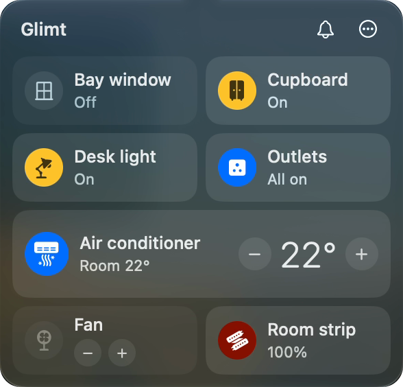
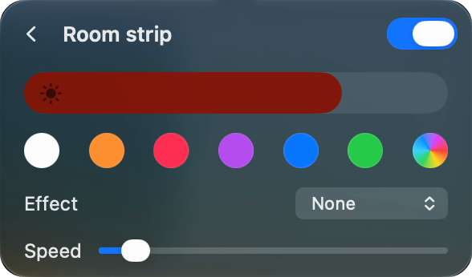
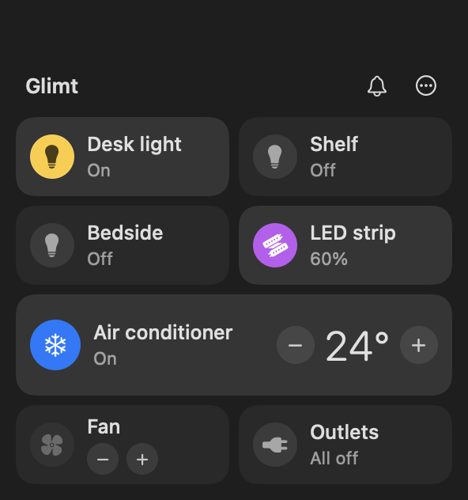

# The menu bar app (macOS)

A lightbulb in your menu bar. Click it and your room is there: every device as a tile,
who is waiting for you, and a bell to make the cues stop for a while.

 

## Install

```bash
glimt app install      # builds it, puts it in ~/Applications, opens it at login
glimt app uninstall    # removes the app and its login item
```

It is built on your own Mac from the Swift sources that ship with Glimt, which takes a
few seconds. Nothing is downloaded. It needs macOS 14 or later and Apple's command line
tools (`xcode-select --install`).

`glimt setup` offers to install it for you. On Linux, use the dashboard instead:
`glimt open`.

## Your room

- **Click a tile's icon** to switch that device on or off.
- **Click the rest of the tile** for its controls. A light shows power, brightness and
  colour (six swatches, or any colour from the system picker), plus effect and speed
  if the device has them. Esc or the arrow takes you back.
- **An air conditioner or thermostat** gets a wide tile with its target temperature and
  minus and plus buttons. Its controls add fan speed and whatever modes the device
  reports, such as eco or sleep.
- **A set of plain switches folds into one tile**, so a row of outlets is one tile that
  says "All on". Click it to switch them one by one.
- **A device that only has buttons**, like a fan on an infrared remote, shows those
  buttons on its tile.
- A device that stops answering is dimmed, and hovering over it says why.
- More than sixteen tiles scroll instead of running off the screen.

Everything in the panel is live. Switch a light from Siri or ChatGPT and the tile
follows.

## Who is waiting for you



- While a cue is holding your lights, the lightbulb in the menu bar fills with the cue's
  colour, and the panel shows a banner: which agent, and what it said. The ✕ dismisses
  the cue and puts the lights back.
- After a cue has gone by, it stays in the panel for half an hour, so a glance tells
  you who it was. Older ones are under **⋯ → Recent Cues**.
- **The bell** mutes cues for an hour, until morning, or until you turn them back on.
  Cues that arrive while muted are not lost: they are listed, marked as muted.

## Letting a cloud app in

When ChatGPT or another app in the cloud asks to connect (see
[Remote access](remote.md)), a row appears at the top of the panel with the app's name,
a six-digit code, and **Deny** and **Allow**. The same code is on the app's sign-in
page. Allow it only if the two match and you started the sign-in yourself.

## The ⋯ menu

| | |
| --- | --- |
| Recent Cues | what arrived and when |
| Send a Test Cue | fire any cue, to see what it looks like in your room |
| Agents That Cue You | turn the hooks for Claude Code, Codex and others on or off |
| Connected Apps | cloud apps you have let in; disconnect any of them |
| Add a Device… | opens `glimt setup` in a terminal |
| Check Setup… | opens `glimt doctor` in a terminal |
| Open Dashboard | the same room in your browser |
| Restart Glimt | restarts the background service |
| Quit Glimt Menu | closes the menu bar app; Glimt itself keeps running |

## If the panel says Glimt isn't running

The menu bar app is only a window onto the background service. If the service has
stopped, the panel says so and offers a **Start** button. `glimt doctor` tells you why
it stopped.
